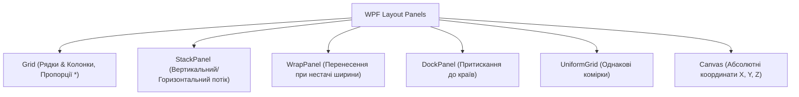

# Layout Panels Showcase

> Інтерактивне візуальне порівняння всіх основних панелей компонування у WPF на платформі .NET 10.



## 🎯 Чому присвячено проект
Коректне компонування — це фундамент WPF. На відміну від абсолютного позиціонування у WinForms, WPF використовує динамічну модель верстки.

### Ключові концепції:
1. **`Grid`**:
   - `Width="*"` — займає залишковий простір.
   - `Width="2*"` — отримує у два рази більше простору, ніж `1*`.
   - `Width="Auto"` — підлаштовується точно під ширину дочірнього контенту.
   - `GridSplitter` — роздільник для зміни розмірів колонок мишею.
2. **`StackPanel`**: просте послідовне розташування. Усі елементи автоматично розтягуються по ширині.
3. **`WrapPanel`**: ідеально для списків тегів, карток каталогу або палітри кольорів.
4. **`DockPanel`**: класичний каркас програми: заголовок угорі (`Top`), статус-бар унизу (`Bottom`), меню ліворуч (`Left`), робоча область у центрі (`LastChildFill="True"`).
5. **`UniformGrid`**: формує сітку однакових розмірів без необхідності вручну прописувати `RowDefinition` та `ColumnDefinition`.
6. **`Canvas`**: використовує координати `Canvas.Left`, `Canvas.Top` та `Panel.ZIndex`.

## 🚀 Як запустити
```bash
dotnet run --project 01-Layout-Panels-Showcase.csproj
```
