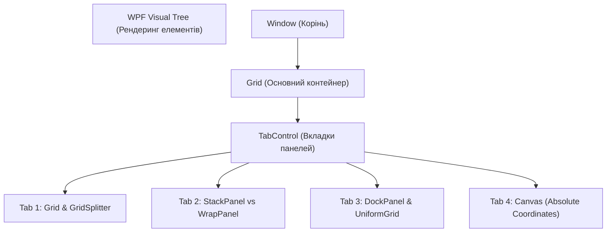

# 01. XAML and Layout Foundations

> Повний посібник із верстки та компонування інтерфейсів у WPF: аналіз візуального та логічного дерева, робота панелей компонування, адаптивність та абсолютне позиціонування.

---

## 📂 Проекти модуля

### `01-Layout-Panels-Showcase`
Інтерактивна вітрина для порівняння та глибокого розуміння роботи кожної панелі:
1. **`Grid`**:
   - `Star (*)` — пропорційний розподіл простору (наприклад `2*` вдвічі більше за `1*`).
   - `Auto` — розмір підлаштовується під вміст елементів.
   - Фіксовані розміри у пікселях.
   - `GridSplitter` — інтерактивна зміна ширини колонок користувачем у реальному часі.
   - `Grid.RowSpan` та `Grid.ColumnSpan`.
2. **`StackPanel`**: послідовне вертикальне або горизонтальне розташування (елементи розтягуються за шириною/висотою за замовчуванням).
3. **`WrapPanel`**: гнучкий потік елементів, що автоматично переносяться на новий рядок при зміні розміру вікна (ідеально для бейджів, тегів, карток товарів).
4. **`DockPanel`**: притискання до сторін (`DockPanel.Dock="Top|Bottom|Left|Right"`) та заповнення залишкового простору останнім елементом (`LastChildFill="True"`).
5. **`UniformGrid`**: сітка з абсолютно однаковими за розміром комірками (ідеально для калькуляторів, шахівниць, дашбордів).
6. **`Canvas`**: абсолютне позиціонування за координатами `Canvas.Left`, `Canvas.Top` та керування шарами `Panel.ZIndex`.

---

## 💡 Поради та Best Practices
* **Не зловживайте `Canvas`**: він не адаптується до зміни роздільної здатності чи розміру вікна. Використовуйте його лише для графічних редакторів, схем та оверлеїв.
* **`Visibility.Collapsed` vs `Visibility.Hidden`**:
  * `Collapsed` — елемент приховується і **не займає місця** у верстці.
  * `Hidden` — елемент невидимий, але **зберігає свій простір** у компонуванні.
