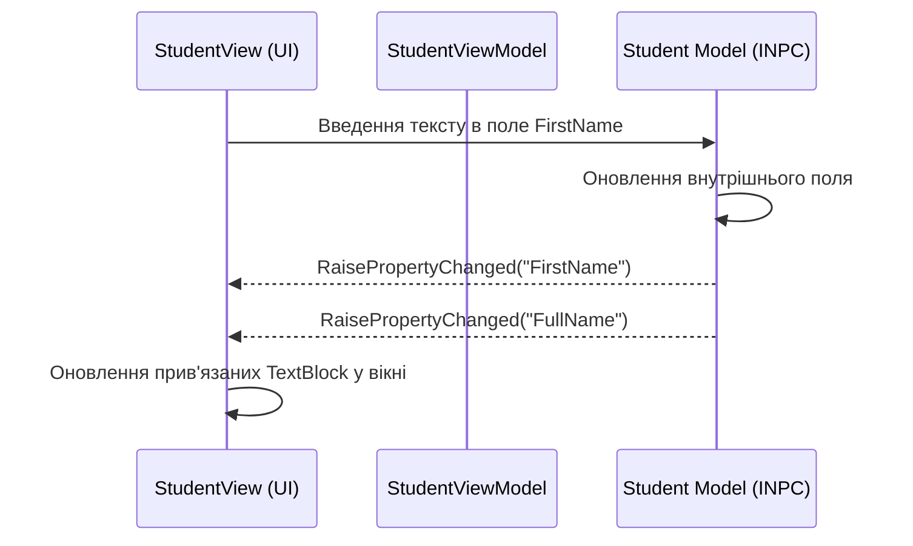

# Basic INotifyPropertyChanged

> Класична реалізація сповіщень інтерфейсу про зміни даних у властивостях ViewModel.



## 🎯 Чому присвячено проект
Демонстрація фундаментального інтерфейсу `System.ComponentModel.INotifyPropertyChanged`. Без нього інтерфейс WPF не може дізнатися, коли змінні в пам'яті C# змінили своє значення.

### Розбір коду:
```csharp
public class Student : INotifyPropertyChanged
{
    private string firstname = string.Empty;
    public string FirstName
    {
        get => firstname;
        set
        {
            if (firstname != value)
            {
                firstname = value;
                RaisePropertyChanged(nameof(FirstName));
                RaisePropertyChanged(nameof(FullName)); // Похідна властивість оновлюється автоматично
            }
        }
    }
}
```

## 🚀 Як запустити
```bash
dotnet run --project MVVM_Example_01.csproj
```
