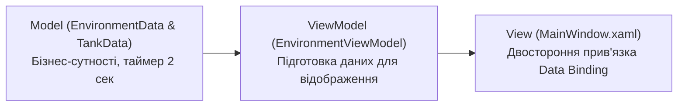

# Model-ViewModel Separation

> Чіткий поділ бізнес-моделі (Model) та логіки представлення (ViewModel) із симуляцією оновлення датчиків у реальному часі.



## 🎯 Чому присвячено проект
Показує, чому не варто змішувати бізнес-логіку з віконними елементами:
- **`Models`**: сутності `EnvironmentData` (температура, вологість) та `TankData` (рівень палива), які оновлюються фоновим таймером.
- **`ViewModels`**: класи `EnvironmentViewModel` та `TankViewModel`, які підписуються на події моделей та транслюють їх у безпечний для WPF вигляд.

## 🚀 Як запустити
```bash
dotnet run --project MVVM_Example_02.csproj
```
