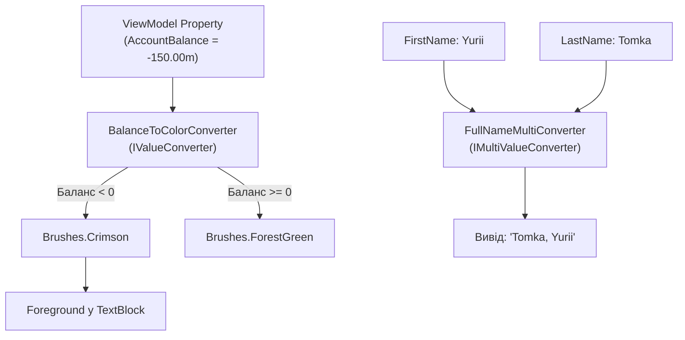

# Value Converters and MultiBinding

> Трансформація даних між джерелом (ViewModel) та споживачем (View) за допомогою `IValueConverter` та `IMultiValueConverter`.



## 🎯 Чому присвячено проект
Часто тип даних у ViewModel не відповідає типу, який очікує контрол у XAML (наприклад, `bool` треба перетворити у `Visibility`, або числове значення балансу у колір `Brush`).

### Реалізовані конвертери:
1. **`BoolToVisibilityConverter`**: замінює `true` $	o$ `Visible`, `false` $	o$ `Collapsed`.
2. **`BalanceToColorConverter`**: динамічно підсвічує від'ємний баланс червоним, а позитивний — зеленим кольором.
3. **`FullNameMultiConverter`**: приймає масив значень (`object[] values`) від `<MultiBinding>` і збирає повне ім'я.

## 🚀 Як запустити
```bash
dotnet run --project 03-Value-Converters-And-MultiBinding.csproj
```
