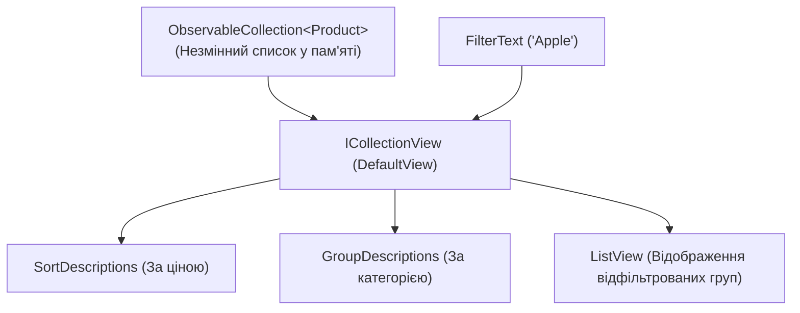

# ObservableCollection and CollectionView

> Робота зі списками: автоматичне оновлення інтерфейсу через `ObservableCollection<T>` та миттєва фільтрація, сортування і групування через `ICollectionView`.



## 🎯 Чому присвячено проект
Поширена помилка початківців — при кожному введенні символу у поле пошуку робити LINQ-запит `Products.Where(...)` і перезаписувати всю колекцію.
Правильний WPF-підхід — використання **`ICollectionView`**:
- Вихідна колекція `ObservableCollection` залишається незмінною.
- Фільтр `ProductsView.Filter = FilterPredicate` миттєво приховує зайві елементи.
- `ProductsView.GroupDescriptions` дозволяє у XAML задати гарний `GroupStyle` із заголовками категорій.

## 🚀 Як запустити
```bash
dotnet run --project 04-ObservableCollection-And-CollectionView.csproj
```
