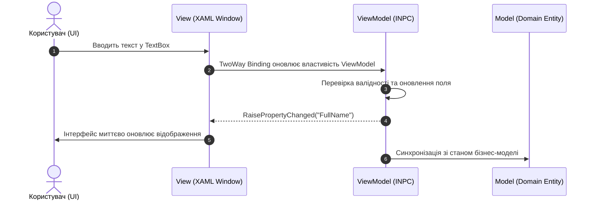

# 02. Data Binding and Classic MVVM

> Фундамент патерну MVVM (Model-View-ViewModel): механізми прив'язки даних (Data Binding), інтерфейс `INotifyPropertyChanged`, одно- та багатозначні конвертери (`IValueConverter`, `IMultiValueConverter`) та робота з динамічними колекціями `ObservableCollection` і `ICollectionView`.

---

## 📂 Проекти модуля

### 1. `01-Basic-INotifyPropertyChanged`
* Базова класична реалізація інтерфейсу `INotifyPropertyChanged`.
* Генерація події `PropertyChanged?.Invoke(this, new PropertyChangedEventArgs(propertyName))`.
* Складені властивості (`FullName` автоматично реагує на зміни `FirstName` та `LastName`).

### 2. `02-Model-ViewModel-Separation`
* Архітектурний розподіл на шари `Models/` та `ViewModels/`.
* Прив'язка таймера оновлення даних середовища (`EnvironmentData`) та рівня палива (`TankData`).
* Робота `UpdateSourceTrigger=PropertyChanged` для моментального відгуку.

### 3. `03-Value-Converters-And-MultiBinding`
* **`BoolToVisibilityConverter`**: трансляція логічного прапорця `IsVipMember` у стан відображення `Visibility`.
* **`BalanceToColorConverter`**: динамічна зміна кольору тексту залежно від знаку балансу (зелений при $\ge 0$, червоний при $< 0$).
* **`FullNameMultiConverter`**: використання `IMultiValueConverter` для об'єднання кількох джерел даних в один вивід.
* Форматування у XAML: `StringFormat='{}{0:C}'`, `TargetNullValue`, `FallbackValue`.

### 4. `04-ObservableCollection-And-CollectionView`
* **`ObservableCollection<T>`**: автоматичне сповіщення інтерфейсу при додаванні/видаленні елементів (`INotifyCollectionChanged`).
* **`ICollectionView`**:
  * Пошукова фільтрація рядків на льоту без видалення даних із колекції.
  * Багаторівневе сортування (`SortDescriptions`).
  * Групування (`GroupDescriptions`) за категорією з кастомним `GroupStyle`.
