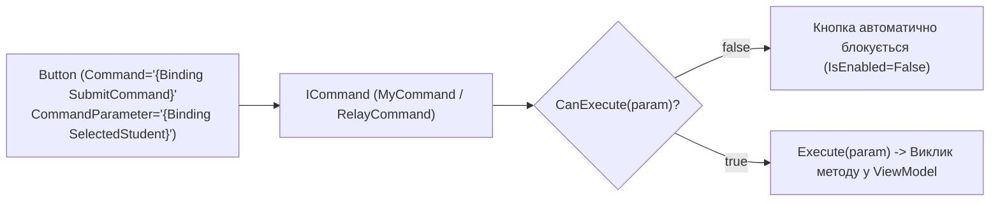

# RelayCommand Basics

> Класичний патерн передачі команд від кнопок інтерфейсу до методів ViewModel через `ICommand`.



## 🎯 Чому присвячено проект
Пояснює, як позбутися обробників подій `Button_Click` у файлах `.xaml.cs` та замінити їх чистими командами.

### Ключові елементи:
- **`ICommand`**: інтерфейс із методами `Execute`, `CanExecute` та подією `CanExecuteChanged`.
- **`CommandManager.RequerySuggested`**: вбудований у WPF механізм, який автоматично опитує `CanExecute` при будь-якій зміні фокусу або введенні даних.
- **`CommandParameter`**: передача контекстного об'єкта із XAML у метод команди.

## 🚀 Як запустити
```bash
dotnet run --project MVVM_Example_04_Commands.csproj
```
