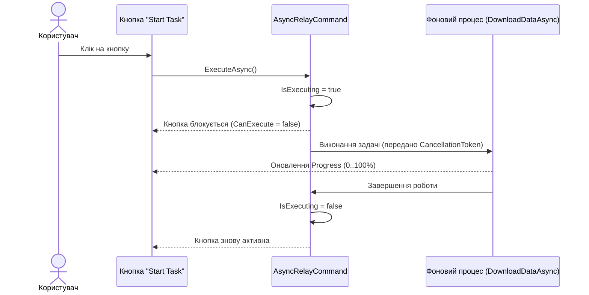

# Async RelayCommand with Cancellation

> Безпечне виконання тривалих фонових операцій із запобіганням подвійним клікам та підтримкою скасування через `CancellationToken`.



## 🎯 Чому присвячено проект
Стандартний `ICommand.Execute(object)` є синхронним методом (`void`). Якщо викликати `await` всередині `async void`, неможливо контролювати статус виконання операції.
`AsyncRelayCommand`:
1. Встановлює `IsExecuting = true`, блокуючи кнопку на час запиту.
2. Створює `CancellationTokenSource`, дозволяючи окремій кнопці "Cancel" скасувати операцію в будь-який момент.
3. Гарантує виконання блоку `finally` для очищення ресурсів.

## 🚀 Як запустити
```bash
dotnet run --project 02-Async-RelayCommand.csproj
```
