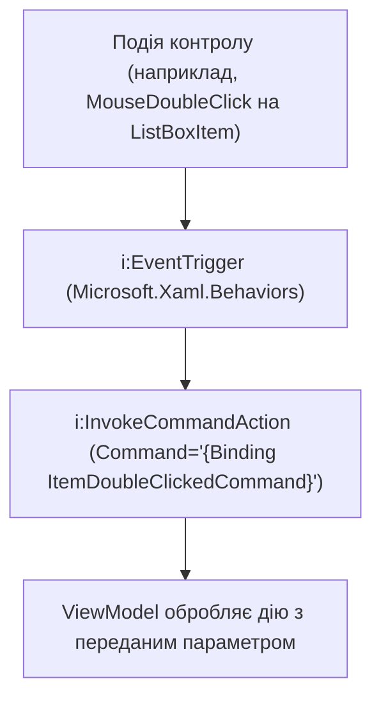

# XAML Behaviors: EventToCommand

> Перехоплення будь-яких подій WPF (подвійний клік миші, завантаження вікна, зміна розміру) та прив'язка їх до команд ViewModel без написання code-behind.



## 🎯 Чому присвячено проект
Більшість елементів WPF (окрім `Button` та `MenuItem`) не мають властивості `Command`. За допомогою пакету `Microsoft.Xaml.Behaviors.Wpf` будь-яка стандартна подія перетворюється у MVVM-команду:
```xml
<i:Interaction.Triggers>
    <i:EventTrigger EventName="MouseDoubleClick">
        <i:InvokeCommandAction Command="{Binding ItemDoubleClickedCommand}"
                               CommandParameter="{Binding SelectedDocument}"/>
    </i:EventTrigger>
</i:Interaction.Triggers>
```

## 🚀 Як запустити
```bash
dotnet run --project 03-Xaml-Behaviors-EventToCommand.csproj
```
