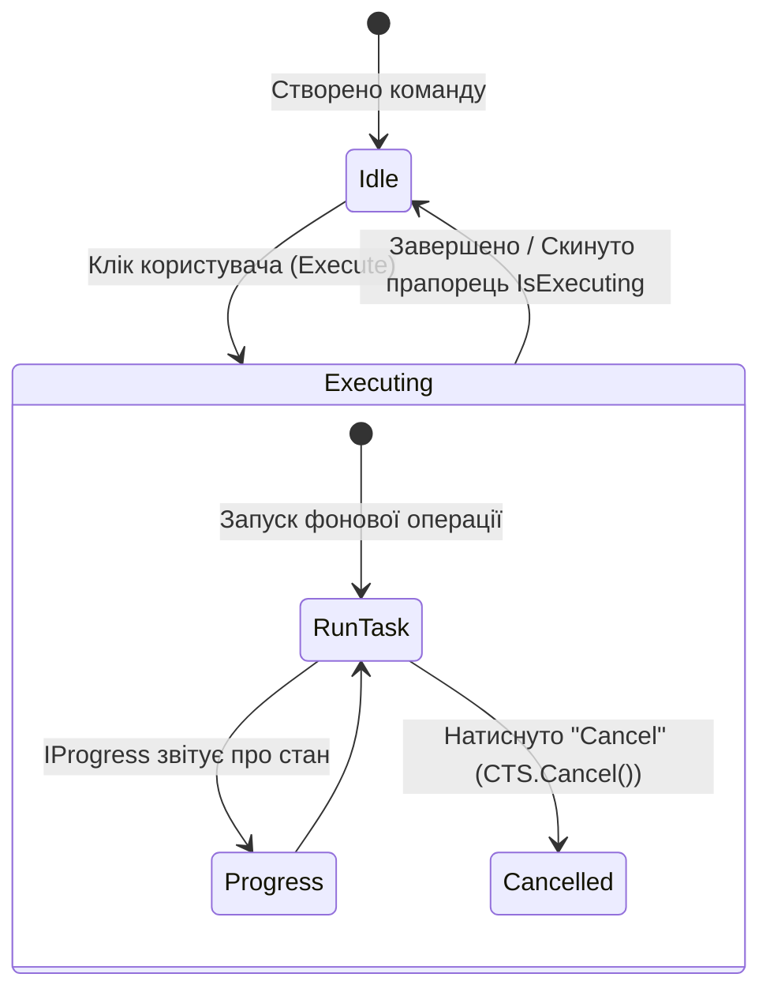

# 03. Commands and User Interactions

> Обробка користувацьких дій без написання коду у code-behind: патерн `ICommand`, `RelayCommand`, асинхронні команди `AsyncRelayCommand` з відміною через `CancellationToken` та прокидання довільних подій контролів через XAML Behaviors.

---

## 📂 Проекти модуля

### 1. `01-RelayCommand-Basics`
* Класична реалізація `ICommand` із делегатами `Action<object>` та `Predicate<object>`.
* Перевірка доступності команди через `CanExecute` та автооновлення стану кнопок через `CommandManager.RequerySuggested`.
* Передача параметрів кнопки через `CommandParameter`.

### 2. `02-Async-RelayCommand`
* Асинхронне виконання тривалих операцій `Func<CancellationToken, Task>`.
* Керування станом зайнятості `IsExecuting` — кнопка автоматично блокується на час виконання для запобігання подвійних кліків.
* Інтеграція `CancellationTokenSource`: кнопка скасування операції перериває завантаження без підвисання UI.

### 3. `03-Xaml-Behaviors-EventToCommand`
* Бібліотека `Microsoft.Xaml.Behaviors.Wpf`.
* Перетворення подвійного кліку миші (`MouseDoubleClick`) на елементі списку у виклик команди `ItemDoubleClickedCommand` з передачею вибраного документа.
* Прив'язка події завантаження вікна `Loaded` до ініціалізаційної команди ViewModel.
