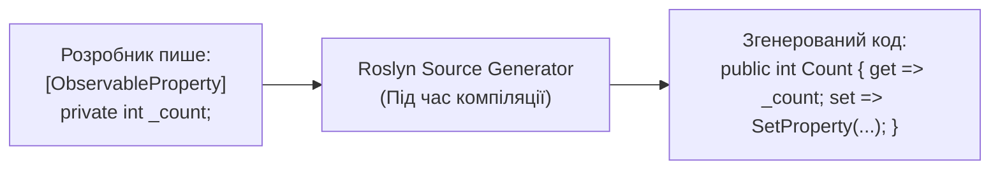

# CommunityToolkit.Mvvm Basics

> Використання сучасних Source Generators для автоматичної генерації коду властивостей та команд.



## 🎯 Чому присвячено проект
Бібліотека `CommunityToolkit.Mvvm` (офіційно від Microsoft) позбавляє розробника рутинного написання 90% шаблонного коду.
- `[ObservableProperty]` створює повноцінну властивість.
- `[RelayCommand]` автоматично генерує команду `IncrementCommand` для методу `Increment()`.
- `[NotifyPropertyChangedFor(nameof(...))]` повідомляє інтерфейс про необхідність оновити залежні обчислювані поля.

## 🚀 Як запустити
```bash
dotnet run --project 01-CommunityToolkit-Basics.csproj
```
