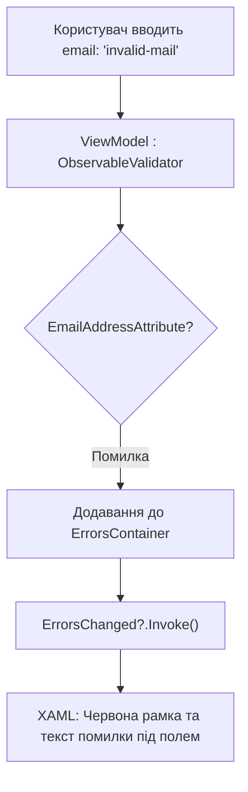

# ObservableValidator and DataAnnotations

> Професійна валідація форм у WPF за допомогою атрибутів `[Required]`, `[EmailAddress]`, `[Range]` та інтерфейсу `INotifyDataErrorInfo`.



## 🎯 Чому присвячено проект
`ObservableValidator` із `CommunityToolkit.Mvvm` поєднує стандартні атрибути валідації .NET із механізмом `INotifyDataErrorInfo` у WPF.
У проекті реалізовано кастомний `Validation.ErrorTemplate`, завдяки якому тексти помилок виводяться безпосередньо під відповідним полем введення.

## 🚀 Як запустити
```bash
dotnet run --project 03-ObservableValidator-And-Validation.csproj
```
