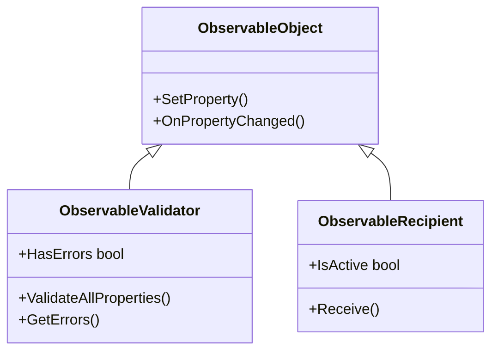

# 04. Modern MVVM Community Toolkit

> Сучасний індустріальний стандарт .NET: бібліотека `CommunityToolkit.Mvvm` (v8.4+). Source Generators (генерація властивостей та команд під час компіляції), слабкопов'язані повідомлення `WeakReferenceMessenger` та валідація сутностей через `ObservableValidator`.

---

## 📂 Проекти модуля

### 1. `01-CommunityToolkit-Basics`
* **Source Generators**:
  * `[ObservableProperty]` — автоматично розгортає приватне поле `_count` у повноцінну публічну властивість `Count` з викликом `OnPropertyChanged`.
  * `[RelayCommand]` — перетворює звичайний метод у команду `IncrementCommand`.
  * `[NotifyPropertyChangedFor(nameof(StatusMessage))]` — автоматичне сповіщення залежних розрахункових властивостей.

### 2. `02-WeakReference-Messenger`
* Патерн **Pub/Sub (Publish/Subscribe)** без жорстких посилань між класами:
  * `WeakReferenceMessenger.Default.Send(new NotificationMessage(...))`
  * `WeakReferenceMessenger.Default.Register<NotificationMessage>(this)`
* Усунення класичної проблеми витоків пам'яті через підписки на стандартні C# `event`.

### 3. `03-ObservableValidator-And-Validation`
* Наслідування від `ObservableValidator`.
* Валідація властивостей за допомогою атрибутів `System.ComponentModel.DataAnnotations`:
  * `[Required]`, `[EmailAddress]`, `[MinLength]`, `[Range]`.
* Реалізація `INotifyDataErrorInfo` у зв'язці з кастомним `Validation.ErrorTemplate` у XAML.
