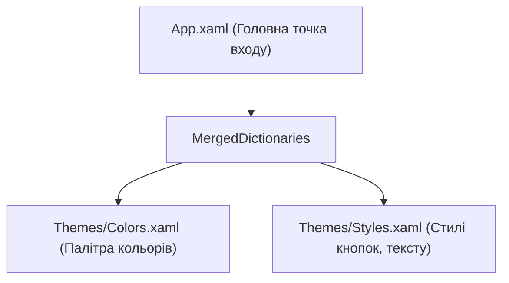

# Merged Dictionaries and Resources

> Модульна організація палітри кольорів та глобальних стилів по окремих файлах `.xaml`.



## 🎯 Чому присвячено проект
Зберігання всіх стилів у єдиному файлі `App.xaml` призводить до нечитабельного коду в тисячі рядків. Проект демонструє:
- Створення зовнішніх словників ресурсів.
- Їх об'єднання через `ResourceDictionary.MergedDictionaries`.
- Відмінність між `StaticResource` (одноразове зчитування при створенні вікна) та `DynamicResource` (динамічна зміна кольору в рантаймі).

## 🚀 Як запустити
```bash
dotnet run --project 01-Resources-And-MergedDictionaries.csproj
```
