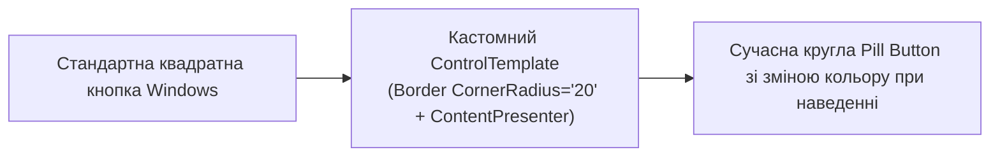

# ControlTemplates from Scratch

> Повна заміна візуального каркаса стандартних кнопок та полів WPF за допомогою `ControlTemplate`.



## 🎯 Чому присвячено проект
Стилі (`Style`) дозволяють змінювати лише властивості (шрифт, колір). Якщо потрібно змінити форму кнопки (наприклад, зробити її повністю круглою, додати іконку або бейдж), використовується **`ControlTemplate`**.
Проект демонструє використання:
- `TemplateBinding` для передачі `Background`, `BorderBrush`, `Padding`.
- `ContentPresenter` як заповнювача для тексту/контенту кнопки.
- Внутрішніх тригерів `ControlTemplate.Triggers` для станів `IsMouseOver` та `IsPressed`.

## 🚀 Як запустити
```bash
dotnet run --project 02-ControlTemplates-From-Scratch.csproj
```
