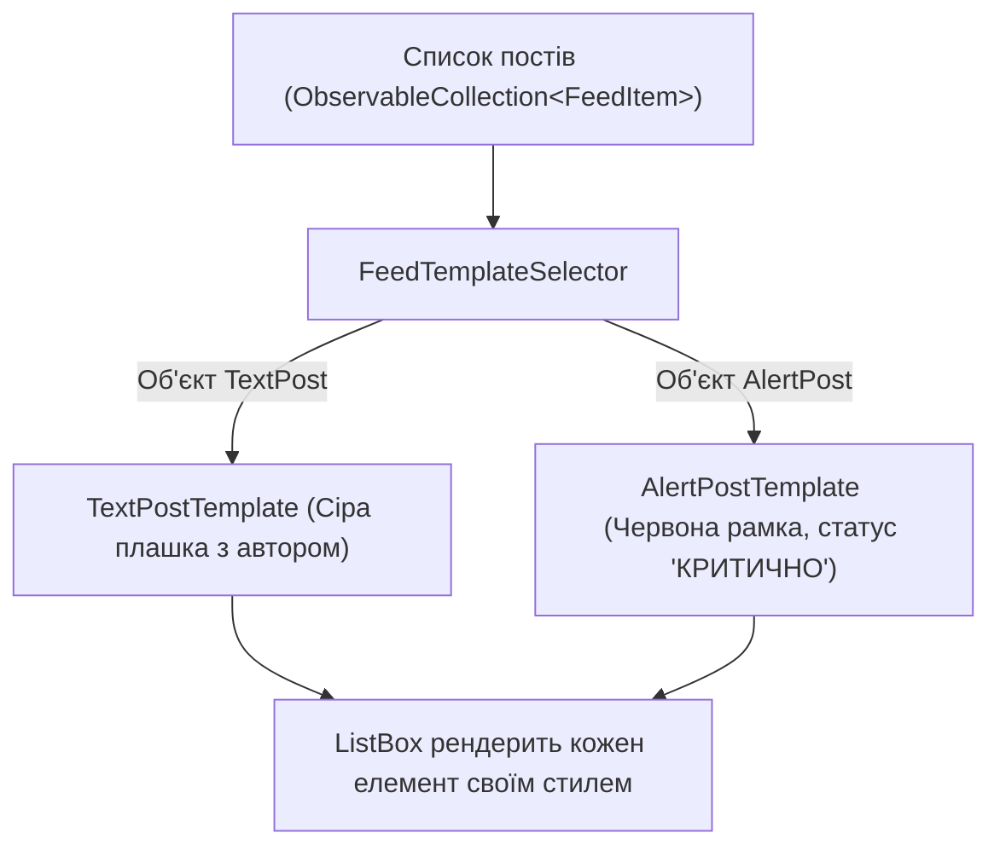

# DataTemplates and TemplateSelectors

> Поліморфне відображення різнорідних об'єктів у списку за допомогою `DataTemplateSelector`.



## 🎯 Чому присвячено проект
Коли колекція містить об'єкти різних класів-спадкоємців (наприклад, текстові повідомлення, системні алерти, вкладення), вони повинні виглядати по-різному.
Клас `DataTemplateSelector` аналізує тип елемента під час побудови візуального дерева та повертає відповідний шаблон `DataTemplate`.

## 🚀 Як запустити
```bash
dotnet run --project 03-DataTemplates-And-Selectors.csproj
```
