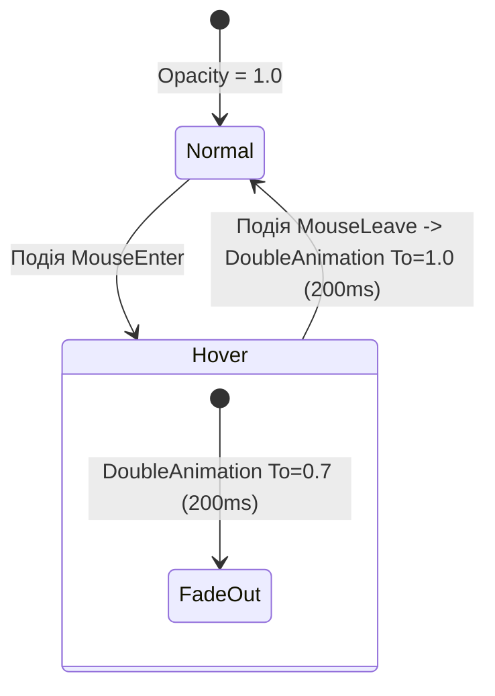

# Triggers and Animations

> Робота з `PropertyTrigger`, `EventTrigger` та плавними анімаціями `Storyboard`.



## 🎯 Чому присвячено проект
Анімації у WPF реалізуються декларативно у XAML без таймерів у C#.
Проект демонструє:
- `EventTrigger` на системні події миші.
- Запуск `Storyboard` із покадровою інтерполяцією `DoubleAnimation`.
- Плавні ефекти затемнення/підсвічування при наведенні курсору.

## 🚀 Як запустити
```bash
dotnet run --project 04-Triggers-And-Animations.csproj
```
