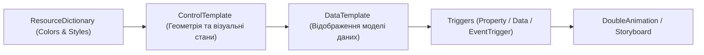

# 05. Styles, Templates and Resources

> Керування зовнішнім виглядом та стилізацією: модульні словники ресурсів `ResourceDictionary`, повна перемальовка стандартних контролів через `ControlTemplate`, вибір поліморфних шаблонів даних через `DataTemplateSelector` та анімації `Storyboard`.

---

## 📂 Проекти модуля

### 1. `01-Resources-And-MergedDictionaries`
* Організація колірних схем (`Themes/Colors.xaml`) та глобальних стилів (`Themes/Styles.xaml`).
* Об'єднання у кореневому `App.xaml` через `<ResourceDictionary.MergedDictionaries>`.
* `StaticResource` vs `DynamicResource`.

### 2. `02-ControlTemplates-From-Scratch`
* Створення сучасної закругленої кнопки (Pill Button) з нуля.
* Використання `TemplateBinding` для передачі кольорів фону, меж та відступів.
* Візуальні тригери `IsMouseOver` та `IsPressed` всередині `ControlTemplate.Triggers`.

### 3. `03-DataTemplates-And-Selectors`
* Відображення поліморфного списку об'єктів (`TextPost`, `AlertPost`).
* Реалізація `FeedTemplateSelector : DataTemplateSelector` для динамічного вибору розмітки за типом об'єкта.

### 4. `04-Triggers-And-Animations`
* Робота з `EventTrigger` на події `MouseEnter` та `MouseLeave`.
* Плавна зміна прозорості `Opacity` за 0.2 секунди через `DoubleAnimation` та `Storyboard`.
