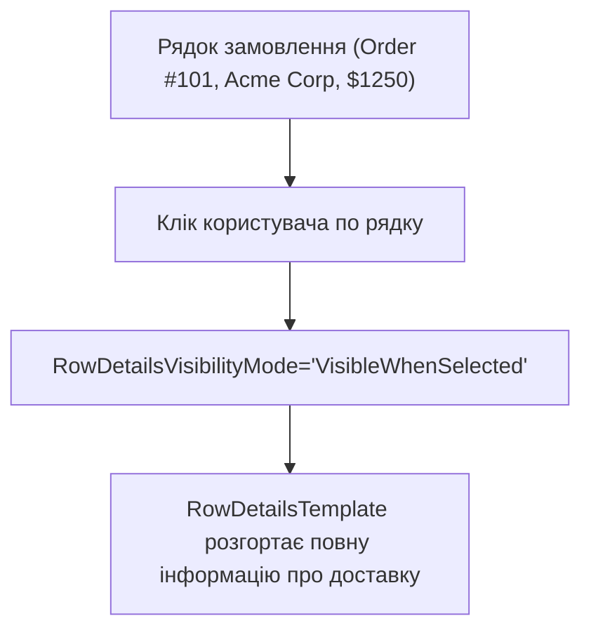

# DataGrid Mastery

> Професійна робота з табличними даними: кастомні колонки, inline-редагування та шаблон деталей рядка `RowDetailsTemplate`.



## 🎯 Чому присвячено проект
`DataGrid` — один із найпотужніших та водночас найскладніших контролів у WPF.
У проекті реалізовано:
- Ручне визначення колонок (`DataGridTextColumn`, `DataGridCheckBoxColumn`).
- `RowDetailsTemplate` — при виборі рядка під ним плавно відкривається блок з адресою та подробицями доставки.
- Форматування сум у валюту (`StringFormat='{}{0:C}'`).

## 🚀 Як запустити
```bash
dotnet run --project 01-DataGrid-Mastery.csproj
```
