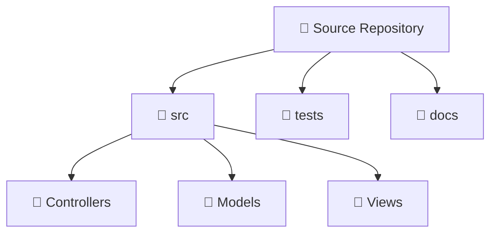

# Hierarchical TreeView

> Побудова рекурсивних деревоподібних структур даних за допомогою `HierarchicalDataTemplate`.



## 🎯 Чому присвячено проект
Звичайний `DataTemplate` не вміє рекурсивно відображати дочірні колекції.
`HierarchicalDataTemplate` приймає параметр `ItemsSource="{Binding Children}"`, що дозволяє WPF автоматично будувати дерево довільної глибини вкладеності.

## 🚀 Як запустити
```bash
dotnet run --project 02-Hierarchical-TreeView.csproj
```
