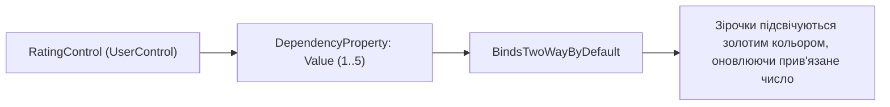

# Custom and UserControls

> Створення компонентів багаторазового використання та реєстрація власних `DependencyProperty`.



## 🎯 Чому присвячено проект
Демонструє створення компонента рейтингу з 5 інтерактивних зірочок:
- Реєстрація `DependencyProperty.Register` для підтримки WPF Data Binding.
- Колбек `OnValueChanged` для миттєвої перемальовки зірочок.
- Інтеграція компонента у будь-яке інше вікно через XML namespace `<c:RatingControl Value="4"/>`.

## 🚀 Як запустити
```bash
dotnet run --project 03-Custom-And-UserControls.csproj
```
