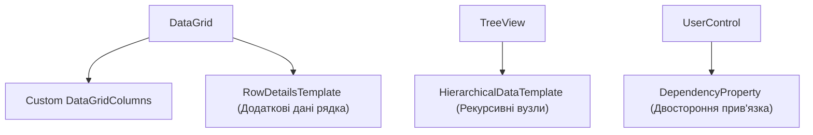

# 06. Advanced Controls and DataGrid

> Професійна робота зі складними табличними та ієрархічними даними: кастомізація `DataGrid` (деталізація рядків `RowDetailsTemplate`), деревоподібні структури `TreeView` з `HierarchicalDataTemplate` та створення власних `UserControl` з `DependencyProperty`.

---

## 📂 Проекти модуля

### 1. `01-DataGrid-Mastery`
* Вимкнення автогенерації колонок (`AutoGenerateColumns="False"`).
* Колонки `DataGridTextColumn`, `DataGridCheckBoxColumn` та `DataGridTemplateColumn`.
* Шаблон розгортання інформації `RowDetailsTemplate` — при виборі замовлення показується повна адреса доставки та примітки.

### 2. `02-Hierarchical-TreeView`
* Рекурсивна модель `DirectoryItem` із колекцією дочірніх елементів `Children`.
* Відображення файлового дерева за допомогою `HierarchicalDataTemplate ItemsSource="{Binding Children}"`.

### 3. `03-Custom-And-UserControls`
* Створення інтерактивного рейтингового контролу `RatingControl` (5 зірок).
* Реєстрація власної властивості залежностей `DependencyProperty.Register`:
  * Підтримка двохстороннього Data Binding (`BindsTwoWayByDefault`).
  * Колбек зміни значення `OnValueChanged`.
