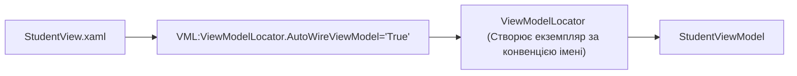

# Classic ViewModelLocator Pattern

> Історичний підхід зв'язування View та ViewModel через статичний локатор сервісів (збережений для порівняння з сучасним DI).



## 🎯 Чому присвячено проект
Патерн `ViewModelLocator` був популярний в епоху Silverlight та WPF 4.0. Він автоматично співставляв назву представлення `StudentView` із класом `StudentViewModel` через рефлексію.
У сучасному .NET 8/10 цей підхід вважається anti-pattern і замінений на повноцінний **Generic Host DI** (див. проект `02-Dependency-Injection-Generic-Host`).

## 🚀 Як запустити
```bash
dotnet run --project MVVM_Example_03_Locator.csproj
```
