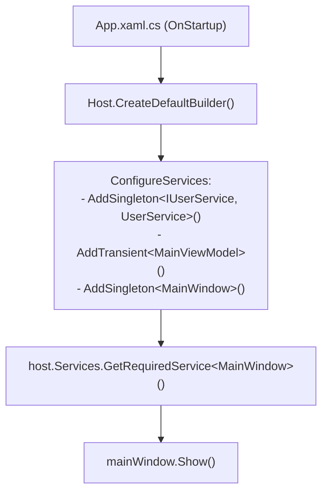

# Dependency Injection with Generic Host

> Сучасне впровадження залежностей у WPF через офіційну бібліотеку `Microsoft.Extensions.Hosting`.



## 🎯 Чому присвячено проект
Показує правильну організацію життєвого циклу WPF-додатку за стандартами бекенду .NET:
- Старт хоста через `await _host.StartAsync()` в `OnStartup`.
- Конструкторне впровадження залежностей: `MainViewModel(IUserService userService)`.
- Graceful shutdown у методі `OnExit`.

## 🚀 Як запустити
```bash
dotnet run --project 02-Dependency-Injection-Generic-Host.csproj
```
