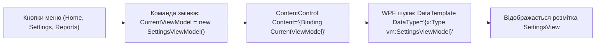

# ViewModel-First Navigation

> Чиста навігація між екранами без виклику вікон із коду.



## 🎯 Чому присвячено проект
При підході **ViewModel-First**:
1. Головне вікно не знає про конкретні View — воно зберігає тільки властивість `CurrentViewModel`.
2. Кожна зміна екрана — це просто присвоєння іншого об'єкта ViewModel.
3. У `ResourceDictionary` прописано відповідність між ViewModel та їхніми шаблонами відображення.

## 🚀 Як запустити
```bash
dotnet run --project 03-ViewModel-First-Navigation.csproj
```
