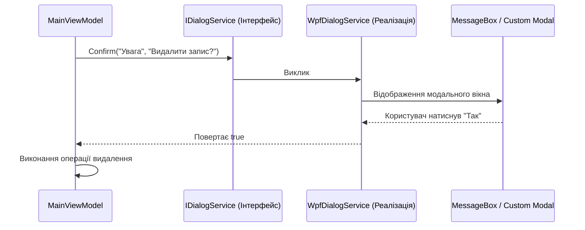

# Modal Dialog Service Pattern

> Відокремлення модальних діалогів від графічної підсистеми для забезпечення 100% тестованості ViewModel.



## 🎯 Чому присвячено проект
Виклик `MessageBox.Show(...)` безпосередньо у ViewModel ламає можливість написання автоматичних юніт-тестів, оскільки тестовий раннер зависне в очікуванні кліку.
Використання `IDialogService` дозволяє під час тестів підставити Mock-об'єкт, який повертає потрібну відповідь без показу вікон.

## 🚀 Як запустити
```bash
dotnet run --project 04-Modal-Dialog-Service.csproj
```
