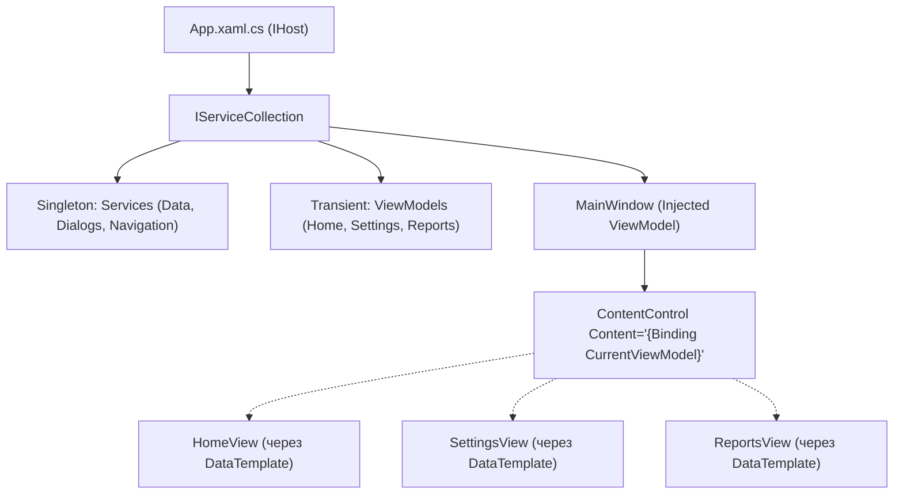

# 07. Dependency Injection and Navigation

> Архітектура корпоративних додатків: впровадження залежностей через `Microsoft.Extensions.Hosting` (Generic Host), чиста ViewModel-First навігація без прив'язки до вікон у C# коді та паттерн `IDialogService` для модальних вікон.

---

## 📂 Проекти модуля

### 1. `01-Classic-ViewModelLocator`
* Історичний підхід на базі статичного локатора сервісів (збережений для архітектурного порівняння).

### 2. `02-Dependency-Injection-Generic-Host`
* Побудова `IHost` на старті додатку в `App.xaml.cs`.
* Реєстрація сервісів у DI: `services.AddSingleton<IUserService, UserService>()`.
* Конструкторне впровадження залежностей у ViewModel та автоматичне розв'язання через `ServiceProvider`.

### 3. `03-ViewModel-First-Navigation`
* Перемикання екранів здійснюється виключно зміною властивості `CurrentViewModel`.
* `MainWindow.xaml` містить `ContentControl Content="{Binding CurrentViewModel}"`.
* Відповідне View підставляється автоматично за допомогою неявних `DataTemplate DataType="{x:Type vm:...}"`.

### 4. `04-Modal-Dialog-Service`
* Інтерфейс `IDialogService` із методом `Confirm(title, message)`.
* ViewModel викликає діалог підтвердження видалення без прямих посилань на `MessageBox` чи класи WPF, що гарантує можливість 100% покриття юніт-тестами.
