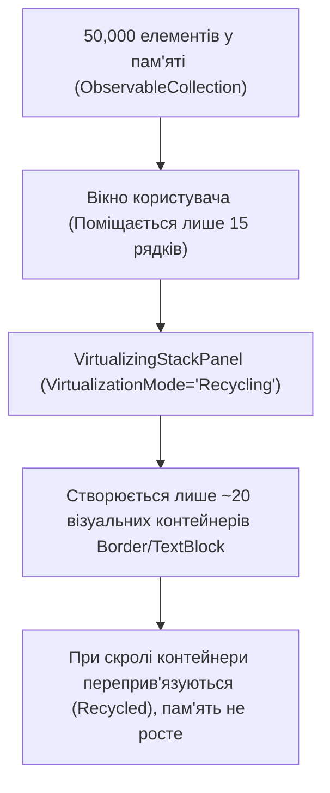

# UI Virtualization for 50,000+ Items

> Високопродуктивна віртуалізація списків у WPF за допомогою `VirtualizingStackPanel`.



## 🎯 Чому присвячено проект
Якщо відобразити 50,000 рядків у звичайному `StackPanel`, WPF створить 50,000 складних UI-об'єктів, що призведе до зависання на кілька хвилин та споживання сотень мегабайт пам'яті.
`VirtualizingStackPanel.IsVirtualizing="True"` та режим `Recycling` миттєво рендерить мільйони записів з плавним скролом.

## 🚀 Як запустити
```bash
dotnet run --project 02-UI-Virtualization-And-Memory.csproj
```
