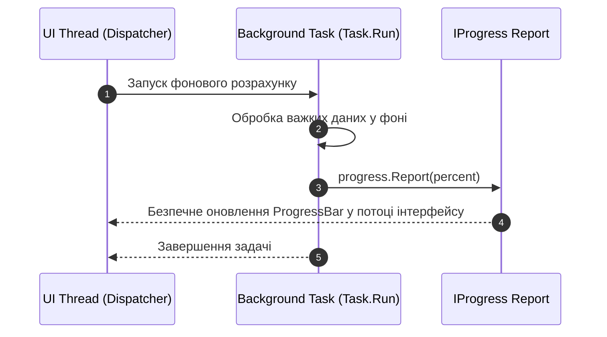

# 08. Multithreading and Performance

> Багатопотоковість, синхронізація з UI-потоком та висока продуктивність: взаємодія через `Dispatcher` та `IProgress<T>`, віртуалізація інтерфейсу `VirtualizingStackPanel` для роботи з 50,000+ записами.

---

## 📂 Проекти модуля

### 1. `01-Dispatcher-And-Background-Tasks`
* Робота важких задач у фоновому потоці через `Task.Run`.
* Безпечна трансляція стану у потік інтерфейсу через `Progress<int>` без блокування вікна.
* Робота з `Dispatcher.InvokeAsync` та пріоритетами черги повідомлень.

### 2. `02-UI-Virtualization-And-Memory`
* Список на **50,000 записів**.
* Налаштування віртуалізації:
  * `VirtualizingStackPanel.IsVirtualizing="True"`
  * `VirtualizingStackPanel.VirtualizationMode="Recycling"`
  * `ScrollViewer.IsDeferredScrollingEnabled="True"`
* Створення візуальних елементів тільки для тих рядків, які безпосередньо відображаються на екрані, що знижує споживання пам'яті у десятки разів.
