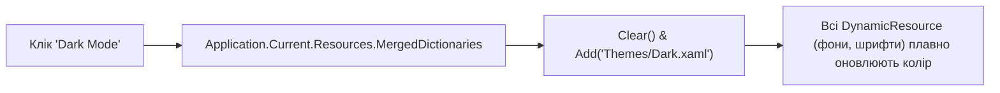

# Runtime Theme Switching and WindowChrome

> Гаряче перемикання світлої та темної теми на льоту та сучасні вікна без стандартних системних рамок за допомогою `WindowChrome`.



## 🎯 Чому присвячено проект
- **Динамічна зміна теми**: використання `DynamicResource` замість `StaticResource` дозволяє на льоту замінити словник ресурсів без перезапуску програми.
- **`WindowChrome`**: прибирає застарілу системну рамку Windows, дозволяючи створити сучасний стиль Windows 11 Fluent Design.

## 🚀 Як запустити
```bash
dotnet run --project 01-Modern-Theming-And-DarkMode.csproj
```
