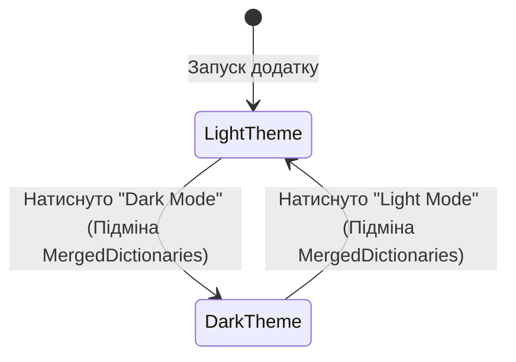

# 09. Modern UI and Fluent Design

> Сучасні інтерфейси та стилізація: гаряче перемикання світлої та темної теми оформлення без перезапуску програми та створення сучасних безрамкових вікон за допомогою `WindowChrome`.

---

## 📂 Проекти модуля

### 1. `01-Modern-Theming-And-DarkMode`
* Динамічна заміна ресурсів у `Application.Current.Resources.MergedDictionaries`.
* Використання `WindowChrome` для стилізації системного заголовка та інтеграції елементів керування у заголовок вікна.
