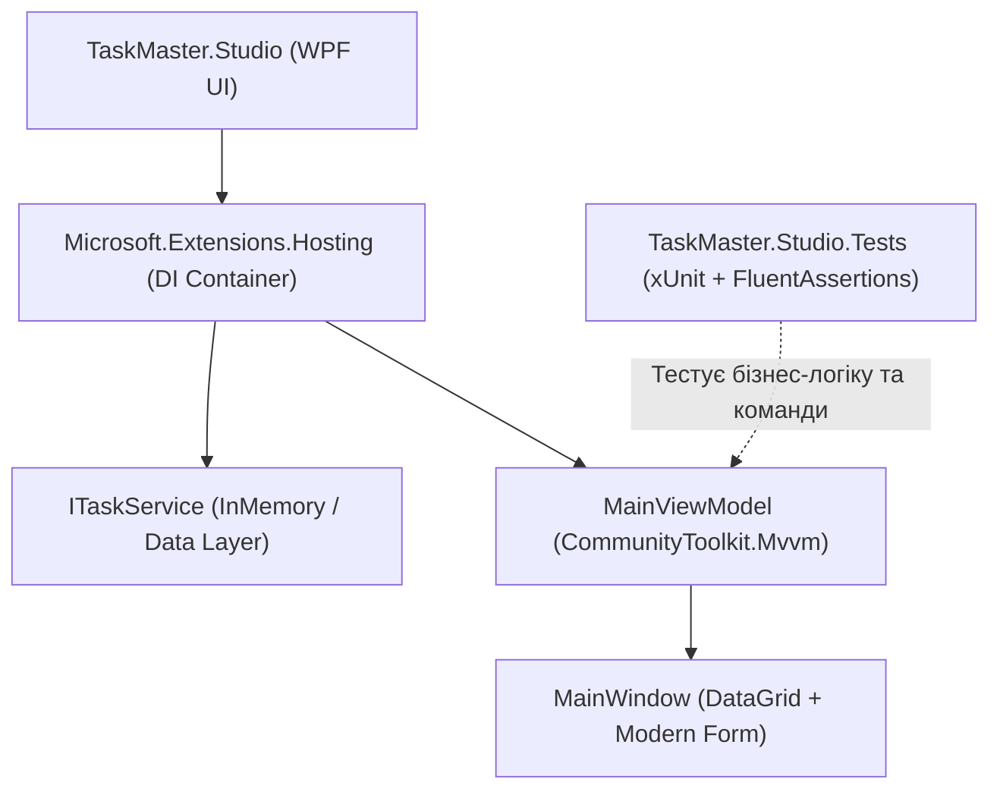

# 10. Capstone Production Application

> Фінальний курсовий проект: повнофункціональний десктопний додаток `TaskMaster.Studio` на базі Clean Architecture, .NET 10, CommunityToolkit.Mvvm, Generic Host DI, DataGrid із шаблонами дій, валідацією та автоматичним тестуванням через xUnit.



---

## 📂 Проекти модуля

### 1. `TaskMaster.Studio`
* **Архітектура:** Чистий розподіл шарів (Models, Services, ViewModels).
* **Стек:** .NET 10 (`net10.0-windows`), `CommunityToolkit.Mvvm` 8.4+, `Microsoft.Extensions.Hosting`.
* **Функціонал:**
  * Управління задачами проєкту (To-Do, In Progress, Done).
  * Пріоритети (Normal, High, Urgent).
  * DataGrid із кастомними колонками та кнопками дій.
  * Фільтрація та створення задач.

### 2. `TaskMaster.Studio.Tests`
* Автоматичні юніт-тести:
  * Тестування команди додавання задачі `CreateTaskCommand`.
  * Тестування команди видалення `DeleteTaskCommand`.
  * Перевірка очищення полів форми та реакцій колекцій за допомогою `FluentAssertions`.

### 🚀 Запуск тестів:
```bash
dotnet test 10-Capstone-Production-Application/TaskMaster.Studio.Tests
```
