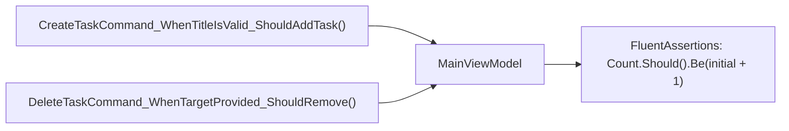

# TaskMaster Studio Automated Tests

> Комплект модульних тестів (Unit Tests) на базі `xUnit` та `FluentAssertions` для перевірки бізнес-логіки та команд ViewModel.



## 🎯 Чому присвячено проект
Показує, як правильно тестувати WPF-додатки без запуску графічного вікна:
- Перевірка виконання команд `vm.CreateTaskCommand.Execute(null)`.
- Перевірка реакції колекцій на додавання та видалення.
- Моніторинг очищення полів після успішного збереження.

## 🚀 Як запустити тести
```bash
dotnet test TaskMaster.Studio.Tests.csproj
```
