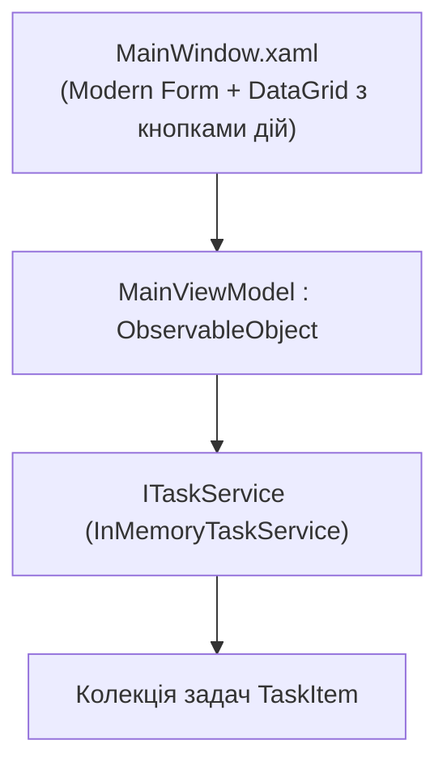

# TaskMaster Studio (Production Desktop Client)

> Фінальний виробничий додаток для управління задачами на базі Clean Architecture, .NET 10, CommunityToolkit.Mvvm та Generic Host DI.



## 🎯 Чому присвячено проект
Об'єднує всі концепції курсу в одному додатку:
- **`CommunityToolkit.Mvvm`**: властивості `[ObservableProperty]`, команди `[RelayCommand]`.
- **`Microsoft.Extensions.Hosting`**: конфігурація контейнера сервісів у `App.xaml.cs`.
- **`DataGrid`**: стилізовані колонки, вибір пріоритетів (Normal, High, Urgent), видалення замовлень за допомогою `CommandParameter="{Binding}"`.
- **Фільтрація та створення задач**.

## 🚀 Як запустити
```bash
dotnet run --project TaskMaster.Studio.csproj
```
