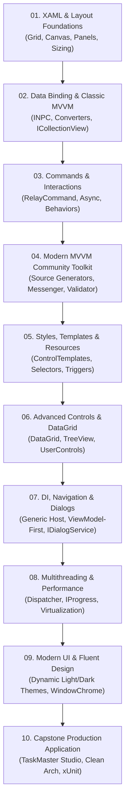

# WPF & MVVM Complete Mastery (.NET 10)

> Найповніший практичний курс та посібник з розробки надійних, високопродуктивних настільних додатків на платформі **WPF** та **.NET 10** з використанням шаблону проєктування **MVVM (Model-View-ViewModel)**.

[](https://dotnet.microsoft.com/)
[](https://learn.microsoft.com/dotnet/desktop/wpf/)
[](https://learn.microsoft.com/dotnet/communitytoolkit/mvvm/)
[]()
[]()

---

## 🗺️ Загальна карта курсу



---

## 📚 Модулі курсу

| Модуль | Назва модуля | Проекти та технології |
| :---: | :--- | :--- |
| **01** | **[XAML & Layout Foundations](01-XAML-And-Layout-Foundations)** | Верстка та компонування: `Grid` (Star, Auto, GridSplitter), `StackPanel`, `WrapPanel`, `DockPanel`, `UniformGrid`, `Canvas`. |
| **02** | **[Data Binding & Classic MVVM](02-DataBinding-And-Classic-MVVM)** | Прив'язка даних: `INotifyPropertyChanged`, поділ на Model/ViewModel, конвертери значень `IValueConverter`, `IMultiValueConverter`, `ObservableCollection` та жива фільтрація через `ICollectionView`. |
| **03** | **[Commands & User Interactions](03-Commands-And-Interactions)** | Обробка дій: патерн `ICommand`, `RelayCommand`, асинхронні команди `AsyncRelayCommand` з відміною через `CancellationToken`, події миші та вікон через `Microsoft.Xaml.Behaviors.Wpf`. |
| **04** | **[Modern MVVM Community Toolkit](04-Modern-MVVM-Community-Toolkit)** | Сучасний стек `CommunityToolkit.Mvvm` (v8.4+): генератори вихідного коду `[ObservableProperty]` та `[RelayCommand]`, шина повідомлень `WeakReferenceMessenger` та валідація через `ObservableValidator`. |
| **05** | **[Styles, Templates & Resources](05-Styles-Templates-And-Resources)** | Словники ресурсів `MergedDictionaries`, перемальовка кнопок і полів з нуля через `ControlTemplate`, вибір поліморфних шаблонів через `DataTemplateSelector`, тригери та плавні анімації `Storyboard`. |
| **06** | **[Advanced Controls & DataGrid](06-Advanced-Controls-And-DataGrid)** | Таблиці `DataGrid` з `RowDetailsTemplate`, рекурсивні дерева `TreeView` з `HierarchicalDataTemplate`, розробка власних `UserControl` з властивостями залежностей `DependencyProperty`. |
| **07** | **[DI, Navigation & Dialogs](07-Dependency-Injection-And-Navigation)** | Архітектура: `Microsoft.Extensions.Hosting` (Generic Host) в `App.xaml.cs`, чиста ViewModel-First навігація через `ContentControl` та сервіс модальних діалогів `IDialogService`. |
| **08** | **[Multithreading & Performance](08-Multithreading-And-Performance)** | Багатопотоковість: `Dispatcher.InvokeAsync`, безпечне оновлення прогресу через `IProgress<T>`, віртуалізація списків на 50,000 елементів через `VirtualizingStackPanel` у режимі `Recycling`. |
| **09** | **[Modern UI & Fluent Design](09-Modern-UI-And-Fluent-Design)** | Гаряче перемикання світлої та темної теми на льоту, створення безрамкових вікон за допомогою `WindowChrome`. |
| **10** | **[Capstone Production Application](10-Capstone-Production-Application)** | Повнофункціональне десктопне рішення `TaskMaster.Studio` на чистій архітектурі та автоматичні юніт-тести бізнес-логіки через `xUnit` і `FluentAssertions`. |

---

## ⚡ Швидкий старт

### Вимоги:
- **.NET SDK 10.0** або новіший (`dotnet --version`)
- **ОС:** Windows 10/11 (WPF є нативною Windows-технологією)
- **IDE:** Visual Studio 2022 (17.12+) або JetBrains Rider / VS Code

### Клонування та збірка всього курсу:
```bash
git clone https://github.com/MrTomkaYurii/WPF-MVVM-Mastery.git
cd WPF-MVVM-Mastery

# Зібрати всі 27 проектів рішення
dotnet build WPF-MVVM-Mastery.slnx

# Запустити модульні тести
dotnet test 10-Capstone-Production-Application/TaskMaster.Studio.Tests
```

---

## 👨‍💻 Авторство та ліцензія
- **Автор:** [Юрій Томка (Yurii Tomka)](https://github.com/MrTomkaYurii)
- **Ліцензія:** MIT License — вільно для навчання, використання та розширення.
